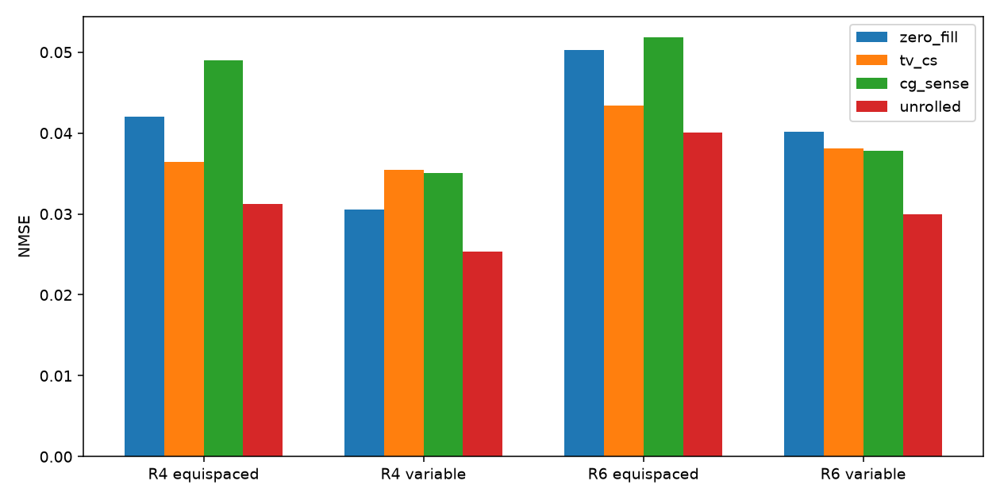
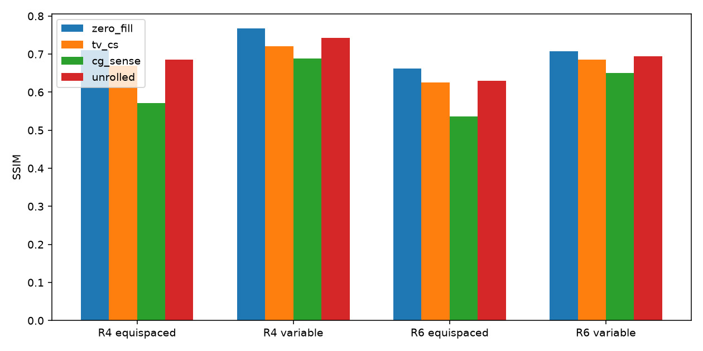
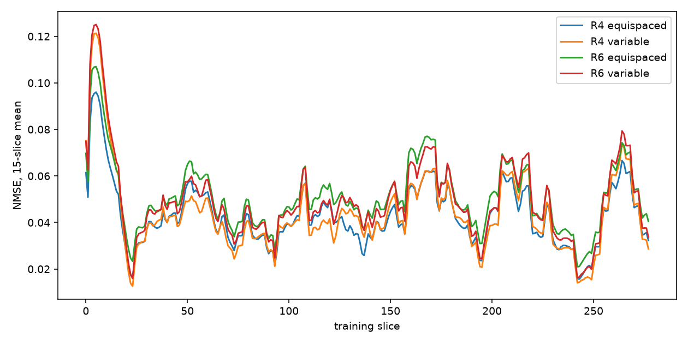
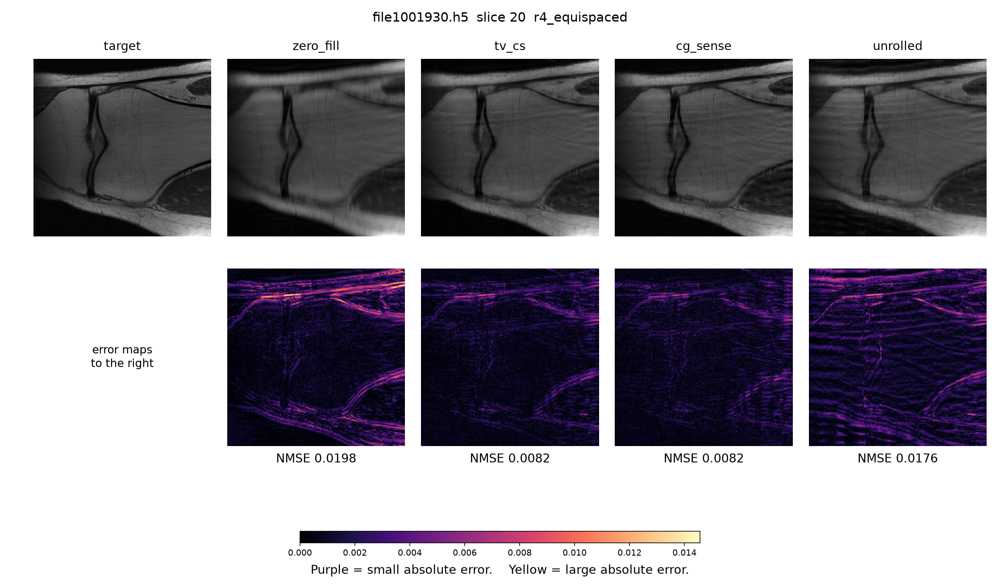
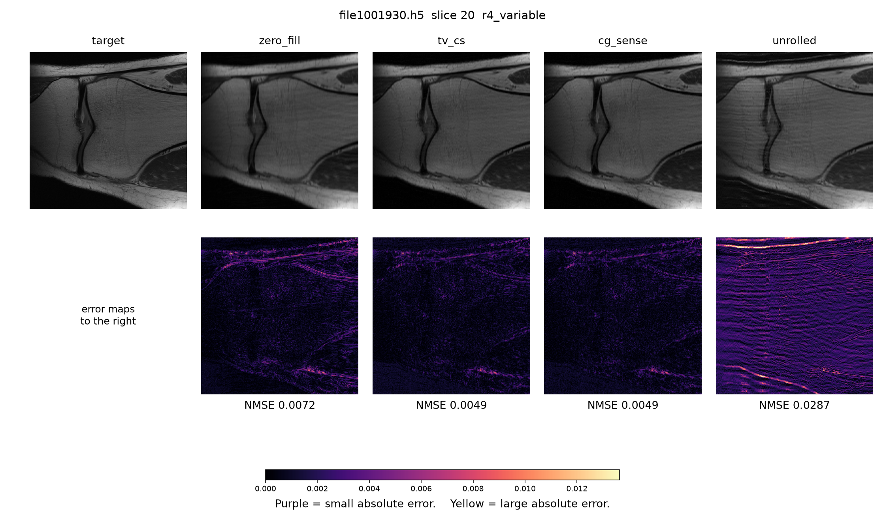
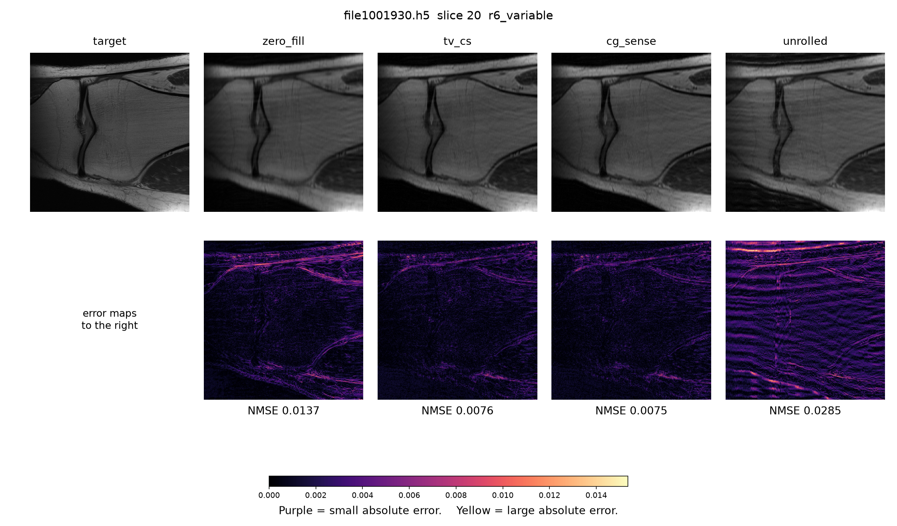

# Multi-coil MRI reconstruction

Accelerated knee MRI, reconstructed with the measurement operator inside the algorithm rather than applied as a black-box denoiser.

    E = M F S

`S` applies coil sensitivities, `F` is a centered orthogonal Fourier transform, and `M` keeps a subset of phase-encode lines. Scan time scales with the number of kept lines. The fully sampled center stays in every mask: it holds most of the signal energy and supplies the coil calibration.

The readout axis has length 640, the usual 2× oversampling, and is cropped to 320 after the inverse transform. That axis stays fully sampled. The mask is applied on the other axis, which is phase encode.



## What was compared

Four methods share `E`:

| Method | What it does |
| --- | --- |
| Zero-filled inverse FFT | Leaves missing lines at zero. |
| CG-SENSE | Eight conjugate-gradient steps. Sensitivities come from 24 central phase-encode lines of that scan. |
| TV compressed SENSE | The same least squares plus isotropic total variation. |
| Unrolled network | One shared CNN, five repeats, four CG steps of data consistency after each repeat. |

Coil compression keeps eight virtual coils. The last convolution of the CNN starts at zero, and the data-consistency weight starts near 0.018, so an untrained network stays near the SENSE solution. Each of the four settings below has its own checkpoint, trained for one epoch on the training files only.

A C++ extension implements the coil forward map, the adjoint combination, and the phase-encode mask. The Fourier transform stays in PyTorch. On a synthetic array the C++ results match PyTorch with maximum absolute error 0.

## Held-out test

The public fastMRI knee multi-coil validation release has 199 volumes. Files are split by name, never by slice: 139 train, 20 validation, 40 test. Training never opened the test files. The data-consistency weight was chosen on validation. The test split was then read once.

The table is one central slice from each of the 40 test volumes. Lower NMSE is better. The unrolled network has the lowest NMSE in every cell.

| NMSE | Zero-fill | TV | CG-SENSE | Unrolled |
| --- | ---: | ---: | ---: | ---: |
| R=4 equispaced | 0.0420 | 0.0364 | 0.0490 | **0.0312** |
| R=4 variable density | 0.0305 | 0.0355 | 0.0351 | **0.0253** |
| R=6 equispaced | 0.0503 | 0.0434 | 0.0518 | **0.0401** |
| R=6 variable density | 0.0402 | 0.0381 | 0.0378 | **0.0300** |

PSNR (dB) and SSIM on the same slices:

| PSNR / SSIM | Zero-fill | TV | CG-SENSE | Unrolled |
| --- | --- | --- | --- | --- |
| R=4 equispaced | 26.81 / 0.711 | 28.36 / 0.670 | 27.37 / 0.571 | 28.30 / 0.685 |
| R=4 variable density | 29.09 / 0.767 | 29.01 / 0.720 | 29.05 / 0.689 | 28.92 / 0.742 |
| R=6 equispaced | 26.00 / 0.662 | 26.84 / 0.626 | 26.23 / 0.536 | 26.84 / 0.630 |
| R=6 variable density | 27.38 / 0.707 | 28.23 / 0.686 | 28.28 / 0.650 | 28.20 / 0.694 |



Two patterns repeat. At a fixed acceleration, variable-density sampling leaves a lower zero-filled error than a regular lattice. Raising the acceleration from 4 to 6 raises the error of every method. SSIM still favors zero-filling: the network reduces energy error and does not win structural similarity. CG-SENSE with a 24-line calibration loses to zero-filling on the equispaced masks. That is a limit of this coil estimate. Forcing the learned weight near zero makes the same unrolled graph match CG-SENSE (validation NMSE 0.0118 against 0.0119 on four slices).



## One slice is not the table

These four figures are the central slice of test volume `file1001930.h5`. The top row is the image. The bottom row is the absolute error against the fully sampled reference. The NMSE printed under each error map belongs to this slice only. The 40-volume mean can rank the methods differently, because other slices carry more aliasing. Purple is a small error and yellow is a large one. The bright end of the scale is the largest zero-filled error on this slice.








## What this is not

This is not a clinical study, not a device validation, and not an official fastMRI challenge submission. The archive is the public validation release only, not the full training set. Scores use one central slice per volume. Training was one epoch, 278 slices, about 94 thousand parameters. ESPIRiT, motion, 3D, and non-Cartesian trajectories are outside this repository. Raw k-space is not stored here. The fastMRI license forbids redistributing it.

## Checks that do not use fastMRI

A synthetic 192×192, 8-coil phantom: FFT round-trip error `2.5e-07`, fully sampled RSS error `2.3e-14`. CG-SENSE NMSE is below zero-filling at R=4 and R=6, for both a regular lattice and variable density. A 24-line coil estimate matches the true synthetic sensitivities with magnitude correlation `0.9998` on the phantom support. A resolution phantom keeps a 16-pixel bar pattern and does not restore a deleted 4-pixel pattern.

## Layout

```text
src/mri_recon/    operators, masks, classical solvers, unrolled model
scripts/          checks, training, evaluation, figures
cpp/              coil and mask kernel
figures/          test charts and slice comparisons
Dockerfile        PyTorch image plus h5py, matplotlib, and sigpy